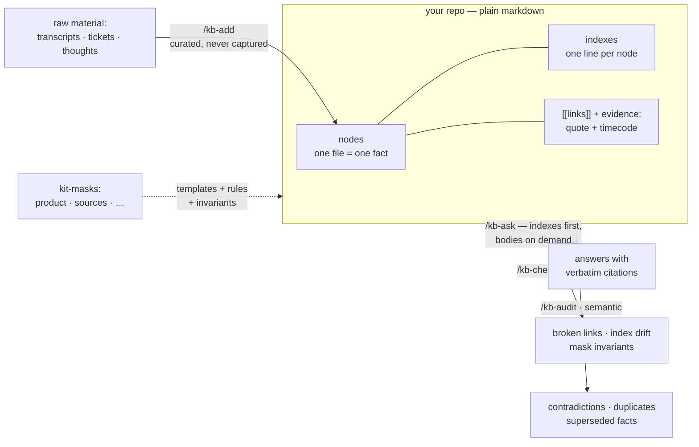

<p align="center">
  
</p>

<p align="center">
  <a href="LICENSE"></a>
  
  
  
  
</p>

**Two weeks of light discipline, and this happens in a fresh session, zero context:**

```text
> /kb-ask what do we know about the solo-founder segment?

Solo founders capture everything and retrieve nothing. They dump every thought
into one ever-growing note and lose it — "I just throw everything into one
note and then can't find anything" (sources/2026-07-06-interview.md, 12:40).
Two of three interviewees stopped taking notes entirely: "I gave up. I just
hope I'll remember" (sources/2026-07-01-interview.md, 08:15).
⚠ hypotheses/one-command-filing is still status: pending — no check run yet.

Sources: insights/dumps-all-into-one-note.md · insights/stopped-taking-notes.md
Read to answer: 2 index files, 3 node bodies — of a 214-node base.
```

Your base answers **in your customers' own words, timecodes included**. And it
catches you drifting from the evidence:

```text
> /kb-audit

1. contradiction — hypotheses/users-want-dashboards.md vs insights/opens-it-monthly.md
   you believed:  "Power users will live in the analytics dashboard"
   users said:    "honestly, I open it maybe once a month" (2026-06-28 call, 22:10)
   → recommend: mark the hypothesis invalidated, link the evidence

Nothing changed yet — every mark waits for your confirmation.
```

That's the whole point: **what you believe and what you heard live in one
graph — and the graph keeps them honest.**

---

# kb-kit

**A knowledge base your AI agent can actually maintain. Just markdown, just git.**

kb-kit turns a folder of markdown files into a disciplined knowledge graph that
Claude Code (and other coding agents) can grow, query, and keep tidy — no
server, no database, no background processes, no embeddings. If you have git
and an agent, you already have everything.

The engine is deliberately **faceless**: nodes, indexes, links, and the
discipline that keeps them honest. What your base *is* — a sales CRM, a
product-discovery vault, a research library — is a **mask** it wears. Put on a
kit-mask with one command and the same graph becomes a different tool; masks
coexist on one base and interlink: your product insights cite the same
interview sources your CRM cites.

## How it works



Three design commitments do the heavy lifting:

- **One node = one fact**, with a one-line `description` — so the agent judges
  relevance from indexes without reading bodies (a question touches ~1–3% of a
  700-file corpus, measured).
- **Evidence citations**: `[[source#^q1]]: "verbatim quote" (12:40)` — every
  claim traces to who said it and when; quotes are grep-verifiable.
- **Nothing is silent**: filing asks when unsure, hygiene proposes before it
  deletes, audit marks contradictions visibly instead of resolving them for you.

## Quickstart

```bash
git clone git@github.com:sergey-zakharov/kb-kit.git ~/tools/kb-kit
cd ~/your-project
~/tools/kb-kit/kb-init.sh                  # new base in kb/
~/tools/kb-kit/kb-init.sh --mask product   # put on the product-development mask
~/tools/kb-kit/kb-init.sh --hooks          # the base starts watching itself
```

Have a docs folder already? `kb-init.sh --migrate docs` adopts it **without
moving a single file** — your conventions win, kb-kit adapts. Leaving?
`--uninstall` removes the toolkit and your knowledge stays plain markdown.

## Commands

| Command | What it does |
|---|---|
| `/kb-add` | Files raw material: picks the theme, writes node + index row in one operation, sets links and evidence citations. Asks when unsure — never guesses silently. |
| `/kb-ask` | Answers from the base with verbatim quotes and file citations, in a fresh session. Honest "the base can't answer" instead of invention. |
| `/kb-check` | Mechanical hygiene in ~1 second: broken links/anchors, index drift, orphans, mask invariants. Safe fixes auto-applied, the rest proposed. |
| `/kb-audit` | Semantic deep-scan: contradictions, near-duplicates, superseded facts — with quoted evidence from both sides. Confirmed findings become visible marks. |
| `/kb-viz` | One self-contained offline HTML: the whole graph, searchable. A file, not an app. |
| `kb-init` | Install, migrate, update, put on masks, wire hooks, uninstall. |

## Masks

A **kit-mask** = node templates + theme rules + hygiene invariants, installed
as one unit. Built-in today:

- **`product`** — product development for new and existing products:
  `insights` (Mom Test enforced: no verbatim quote → not an insight),
  `journeys` (stages link insights; unevidenced stages marked *assumed*),
  `hypotheses` (falsifiable statement + check plan + result — `/kb-check`
  rejects vague beliefs), `decisions` (ADR-light with supersede chains),
  `segments` (defined by evidence, not persona fiction).
- **`sources`** — the source library: one file per material, quotes with
  timecodes and block anchors, ready to be cited by everything else.

Masks are how the project scales sideways: sales CRM, content pipeline,
fundraising — same engine, different discipline. Writing one is writing
markdown.

## Automation (optional)

```bash
~/tools/kb-kit/kb-init.sh --hooks
```

Git pre-commit hygiene (warn-only by default), a base-status line opening every
Claude Code session, per-edit hygiene feedback straight to the agent, and a
CI template staged for when you want it. Filing stays curated — automation
watches hygiene, it never captures content.

## Principles

1. **One node, one fact.**
2. **The index always mirrors the folder.**
3. **Nothing is deleted silently.**
4. **Retrieval is two-stage: index → body.** Selection over compression.
5. **Zero infrastructure.** git is the database, the diff is the review, a PR is how knowledge gets edited.
6. **Curated, not captured.** Facts enter by command. No noise in, no filters needed.

## Battle-tested

Built spec-first (see `specs/`) and validated on three real private corpora
before any release: a 717-file research archive (migrated with **zero files
touched**), a 174-card sales CRM where `/kb-check` rediscovered a documented
index-drift incident in **0.98 s** — 49 unindexed cards plus 4 phantom
references the manual process never caught — and a 4 GB raw client-project
intake where evidence citations were extracted from live call transcripts and
grep-verified. ~140 test assertions across four zero-dependency suites.

## Roadmap

- More kit-masks: sales CRM, content pipeline, `product-management-pro`
  (metrics/OKR for running products)
- Codex adapter (`AGENTS.md`) — the core is already agent-neutral
- Mask registry · optional embeddings cache when a base outgrows grep

## Credits

Distribution model borrowed from GitHub's
[spec-kit](https://github.com/github/spec-kit).

MIT, see [LICENSE](LICENSE).
